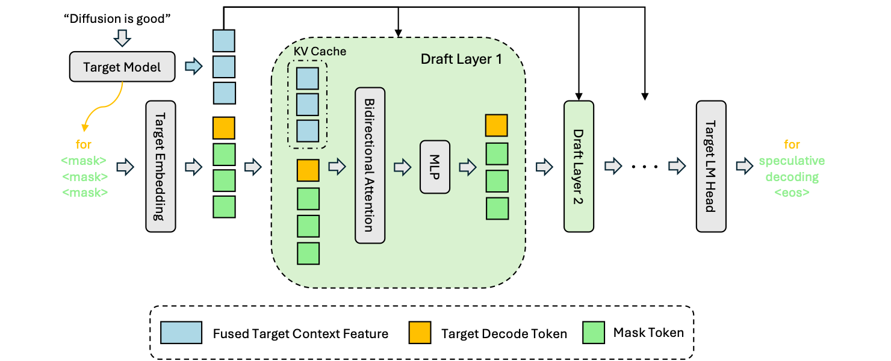

import DrafterCompare from '../../components/DrafterCompare.astro';
import DFlashRound from '../../components/DFlashRound.astro';
import ConvTaps from '../../components/ConvTaps.astro';

S01 left a trade-off: a drafter must be cheap and accurate, and an AR drafter pays one pass per guess. A **diffusion drafter** guesses the whole block in one pass. It brings the problem of every parallel decoder with it (M02, P05): positions guessed together do not see each other.

<DrafterCompare caption="One round for the same context, in toy cost units (one target pass = 1). EAGLE-3 guesses one token per pass with a 1-layer drafter. DFlash 1 fills 8 masks in one pass of a 5-layer drafter, each position on its own. DFlash 2 runs the same pass and picks a path through the candidates. SDAR is a block-diffusion LM writing alone: several steps of the full model, and no check. The thin bar under a draft is its confidence; the bar under each lane is time." />

## DFlash: one step, one pass

DFlash ([notes](../../papers/dflash/)) keeps the target as it is and trains a 5-layer block-diffusion drafter next to it:

- **One step.** The block after the target's last token is all masks, filled in one denoising step. No iterative refinement, unlike a dLLM such as SDAR.
- **It reads the target.** Hidden states from 5 target layers are fused and added as extra keys and values in every drafter layer. Without them the drafter manages 2–3×; with them, about 5×.
- **Depth is affordable.** EAGLE-3 pays one pass per guess, so it uses a single layer. DFlash pays once per block, so it can use five, and its drafts are accepted more.

### One round, in the figure and in code



*Figure 2 of the DFlash paper (Chen, Liang, Liu, CC BY 4.0). The prompt is "Diffusion is good", the target writes "for", and the drafter guesses "speculative decoding `<eos>`" in one pass.*

Read it by colour:

- **Blue, the target's context.** **Hidden states** from 5 target layers, spread from shallow to deep, are concatenated and projected into one vector per position. Every draft layer turns these vectors into extra keys and values and caches them. They are never fed in as input tokens: EAGLE-3 adds target features to its input instead, and they fade as layers are added. {/*  (Table 9). */}
- **Orange, the anchor.** The target's last token, clean. It is the one position in the block the drafter is sure of.
- **Green, the masks.** The 15 positions to guess. Anchor and masks go through the 5 draft layers once, with bidirectional attention inside the block, and the target's own frozen LM head turns them into tokens.

**How the block can attend to target features.** The blue vectors are not tokens next to the block. They only supply keys and values. In each draft layer:

$$
Q = W_Q\,[\text{block}], \qquad K = W_K\,[c_1 \dots c_T;\ \text{block}], \qquad V = W_V\,[c_1 \dots c_T;\ \text{block}]
$$

So only the 16 block positions ask; the matrix is $16 \times (T + 16)$. The context vectors issue no queries and are never updated: every layer projects the same $c_t$ with its own $W_K, W_V$, once, and caches the result. "Bidirectional" covers the block only. The context is all in the past, so reading it breaks no causal order.

This is a prefix KV cache whose prefix was computed by another model, or cross-attention in an encoder–decoder, with the target as the encoder. The drafter never read the prompt itself, so it borrows the target's reading. It can make sense of those vectors because $W_c$ and every $W_K, W_V$ are trained in exactly this setup; the target stays frozen.

The figure stops at the draft. Here is one full round, verification included, with a block of 8:

<DFlashRound caption="One drafter pass fills every mask; one target pass checks them all. Verification is greedy here for clarity (keep a draft if it is the target's top pick); with sampling, the test is min(1, p/q) and the replacement is drawn from the residual (S01). Slots 6 and 7 agree with the target and are still lost: the target computed them after a wrong token." />

The same round in code, with the cache bookkeeping:

```python
def dflash_generate(target_model, draft_model, prompt_ids, max_new_tokens, block_size=16):
    # 1. Prefill the target and keep hidden states from 5 of its layers, evenly
    #    spaced from the 2nd to the 3rd-to-last (e.g. [1, 16, 31, 46, 61] of 64).
    logits, target_kv_cache, hidden_states = target_model.prefill(
        prompt_ids, output_hidden_states=True
    )
    seq_len = len(prompt_ids)                  # positions held in target_kv_cache

    # The target's own next token is the first anchor (orange).
    anchor_token = sample(logits[-1])
    generated_tokens = [anchor_token]

    # Blue: concat the 5 layers -> Linear -> RMSNorm, one vector per position.
    # Every draft layer projects it to K and V and caches them.
    context_features = extract_and_fuse(hidden_states, target_layer_ids)
    draft_kv_cache = draft_model.inject_context_to_kv(context_features)

    while len(generated_tokens) < max_new_tokens and generated_tokens[-1] != EOS:
        # 2. The block: [anchor, MASK, ..., MASK], block_size positions (green masks).
        draft_input_ids = [anchor_token] + [MASK_TOKEN_ID] * (block_size - 1)

        # 3. One forward pass of the drafter = one denoising step. Attention is
        #    bidirectional inside the block and also reads draft_kv_cache.
        draft_logits = draft_model.forward_parallel(
            input_ids=draft_input_ids,
            kv_cache=draft_kv_cache,
            attention_mask="bidirectional_within_block",
        )
        # Slot 0 is the anchor; slots 1..15 are the guesses, each sampled on its
        # own. Keep the probabilities q: sampled verification needs them.
        draft_probs = softmax(draft_logits[1:])
        candidate_tokens = [sample(q) for q in draft_probs]
        block_to_verify = [anchor_token] + candidate_tokens   # block_size tokens

        # 4. The target checks the whole block in one forward pass.
        #    target_logits[i] is its prediction for the token after position i.
        target_logits, hidden_states = target_model.forward(
            input_ids=block_to_verify,
            kv_cache=target_kv_cache,
            output_hidden_states=True,
        )

        # 5. Accept the longest valid prefix (rejection sampling, S01).
        #    Greedy decoding reduces this to: candidate == argmax(target_logits[i]).
        accepted_tokens = []
        for i in range(block_size - 1):
            p, q = softmax(target_logits[i]), draft_probs[i]
            x = candidate_tokens[i]
            if random() < min(1, p[x] / q[x]):
                accepted_tokens.append(x)
            else:
                # First rejection: a corrected token from the residual, then stop.
                accepted_tokens.append(sample(normalize(relu(p - q))))
                break
        else:
            # All 15 accepted: one bonus token from the last position.
            accepted_tokens.append(sample(softmax(target_logits[block_size - 1])))

        generated_tokens.extend(accepted_tokens)
        num_accepted = len(accepted_tokens)   # n accepted drafts + 1 corrected/bonus

        # 6. The target has read the anchor and the n accepted drafts: that is
        #    1 + n = num_accepted positions. Keep their KV, drop the rest.
        seq_len += num_accepted
        target_kv_cache.crop(seq_len)

        # Their hidden states come free from step 4: new blue context.
        new_context = extract_and_fuse(hidden_states[:num_accepted], target_layer_ids)
        draft_kv_cache.append_context(new_context)

        # The target has not read the last token yet: it is the next anchor.
        anchor_token = accepted_tokens[-1]

    return prompt_ids + generated_tokens[:max_new_tokens]
```

Three things the code makes visible:

1. **Verification doubles as the next prefill.** The pass that checks the drafts also yields the target's hidden states for every accepted token, so the drafter's context grows at no extra target cost.
2. **The drafter's cache holds only target features.** The block's own keys and values are recomputed every round, since the block is new each time.
3. **The drafter needs its probabilities $q$**, not just its tokens, for sampled verification (S01). One softmax per position gives them.

{/* The cleanest evidence for the cost argument is Qwen3.5's built-in MTP heads, which draft one token after another. They are accepted about as often as DFlash (6.5 against 7.1 tokens per round) and give half the speedup (1.5× against 3.0×).

The headline "up to 2.5× faster than EAGLE-3" comes from batch-1 runs in HuggingFace Transformers. With both drafters trained on the same data and served by SGLang, DFlash's lead at one request is about 1.3× (2.4× against 1.9×). */}

**What one step costs.** With one step, the guesses inside the block are **independent** given the context. Two things follow:

1. **Neighbours can disagree.** Each position takes its own most likely token. If position 6 is "New" or "San" and position 7 is "York" or "Francisco", each can be the top pick on its own and still give "New Francisco". The target rejects there, and everything after it is lost.
2. **The end of the block is weak.** The farther a position is from the last known token, the less it can be guessed alone. Acceptance falls along the block (suffix decay). DFlash weights the loss toward early positions, which helps training but does not change the shape.

## DFlash 2: keep the pass, fix the block

DFlash 2 (Z Lab and Inco AI, August 2026) has no paper; the source is the [release post](https://inco.ai/blog/dflash2/). It keeps the one-pass drafter and adds two small parts.

**A path selector, for disagreeing neighbours.** Keep the top 16 candidates at each position and score every adjacent pair $(a, b)$:

$$
S_t(a, b) = U_t(b) + \langle A(a) \odot H(h_t),\ B(b) \rangle
$$

$U_t(b)$ is DFlash's own logit for $b$. The second term asks whether $b$ fits after $a$: $A$ and $B$ are small 256-d token embeddings, gated by the drafter's state $h_t$. All scores come from the one pass, with no extra pass of the backbone or the LM head. A walk over them from the anchor, left to right, picks the path: greedy takes the best successor at each step; with sampling, each step samples from the same scores, so rejection sampling still sees an exact probability. It is a learned bigram on top of the drafter: cheap, and enough to turn "New Francisco" into "New York".

**A two-tap convolution, for the end of the block.** Before and after each attention and feed-forward sublayer:

$$
\text{Conv}(x)_t = k_{t,0} \odot x_t + k_{t,1} \odot x_{t-1}
$$

Why a convolution: the post finds suffix decay is a backbone problem, not a selection one. Even an oracle that always picks the right candidate falls from 99.5% at the first position to 87.8% at the last, because the right token is no longer among the candidates. More depth helps the tail, but costs everywhere. And DFlash's attention has two jobs, reading the context and linking positions inside the block, and it drops the second: the block's share of attention falls from 30% in layer 1 to 8% in layer 5. So a separate, cheap module takes the local job.

<ConvTaps caption="Drawn from the description in the DFlash 2 post (its Figure 4). Each draft position mixes its own vector (k₀) with its left neighbour's (k₁); the first draft position reads the anchor, the last verified token. The coefficients are a learned base kernel plus a small correction computed from the hidden state. One conv sits before and after each attention and MLP sublayer, so a position's information moves one step to the right at each conv, while all positions still compute in parallel." />

Recall@1 at each draft position, given that every earlier position was right (Qwen3-4B, GSM8K, greedy, no selector):

| Drafter | Position 0 | Position 3 | Position 6 | Cost over 5 layers |
|---|---|---|---|---|
| DFlash, 5 layers | 85.4% | 78.3% | 72.9% | — |
| DFlash, 15 layers | 86.4% | 80.3% | 78.7% | +15.2% latency |
| DFlash, 5 layers + conv | 85.8% | 79.7% | 77.6% | +3% params, +0.7% latency |

All three start almost the same; they differ toward the end. The convolution recovers most of what ten extra layers buy, so suffix decay is mostly a local problem. Attention to the block in layers 4–5 falls from 9.4% to 0.5%: the convolution takes the local work, and attention goes back to reading the context. It is block-local and keeps no state across rounds, so attention, the LM head and verification stay as in DFlash.

Together they add about 1% to a round and about one accepted token. Matched training, Qwen3.5-4B, mean tokens per round:

| MTP | DFlash | DSpark | DFlash 2 |
|---|---|---|---|
| 4.54 | 4.92 | 5.49 | 5.97 |

{/* Caveats:

- These are the authors' runs, in a post, not a paper.
- On Qwen3.8-27B in SGLang (one H200, GSM8K), DFlash 2 gives 3.43× at one request and 1.45× at 32. The fall with load is the same as DFlash's (S07).
- One independent llama.cpp test (a 2-bit Muse Glimmer 30B on an RTX A4000) finds DFlash 2 a little ahead of DFlash 1 on code, and both slower than no speculation on short Japanese prompts. */}

## Against a dLLM that writes alone

SDAR (P03, M07) is the same idea without a target: an AR model converted to block diffusion, decoding a block in several steps and committing only confident positions per step. It avoids "New Francisco" by waiting, and "York" is committed a step after "New". But every step is a pass of the full model, and nothing checks the result, so the text is only as good as the dLLM.

A diffusion drafter takes the opposite position: one step, a small model, and a target that rejects whatever does not fit. It can afford to be wrong, as long as it is cheap.

## References

1. Chen, Liang, Liu. *DFlash: Block Diffusion for Flash Speculative Decoding*. ICML 2026. [arXiv](https://arxiv.org/abs/2602.06036)
2. Inco AI. *DFlash 2: Keep Drafting Parallel*. 2026. [Post](https://inco.ai/blog/dflash2/)
3. Li et al. *EAGLE-3: Scaling up Inference Acceleration of Large Language Models via Training-Time Test*. 2025. [arXiv](https://arxiv.org/abs/2503.01840)
4. Cheng et al. *SDAR: A Synergistic Diffusion-AutoRegression Paradigm for Scalable Sequence Generation*. 2025.
